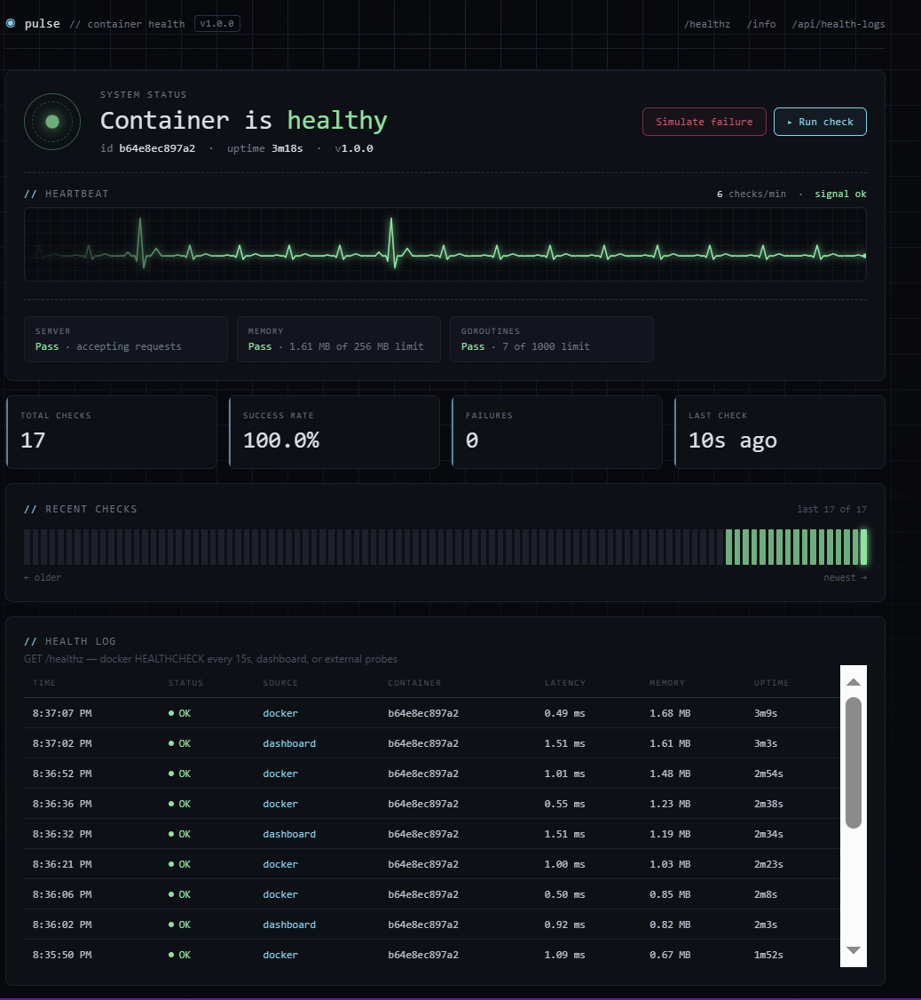
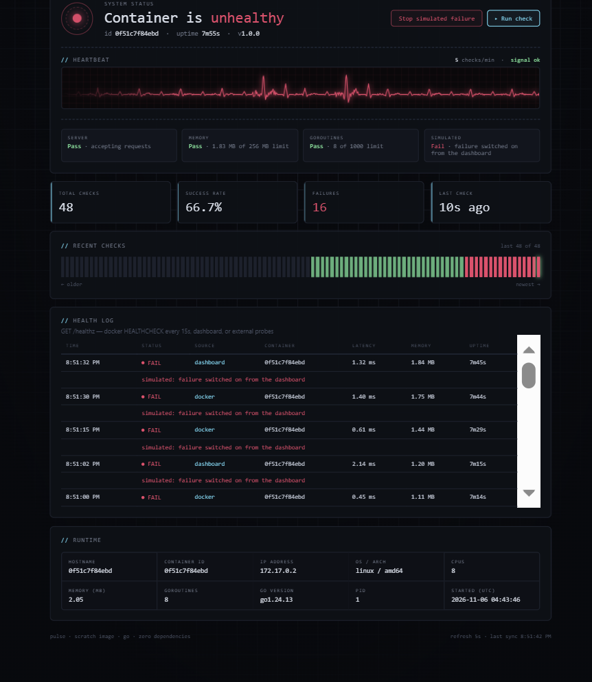
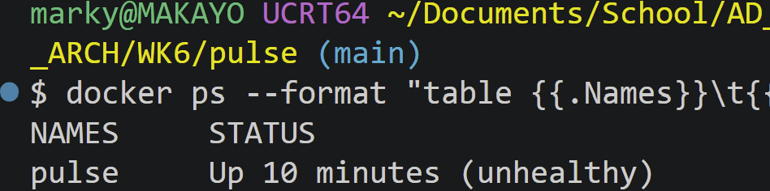
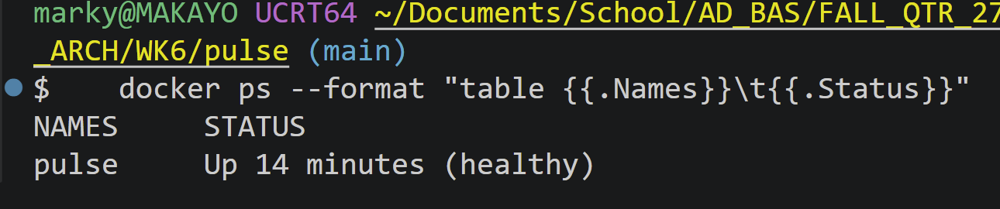

# Pulse: Container Health Dashboard

Pulse is a tiny web app that reports on its own container: live health status, a heartbeat monitor, a health-check log, and runtime metadata (hostname, container ID, IP, memory, uptime). It's built to make container behaviour **visible**: health checks, scaling, failure and self-healing all show up on screen.

- **Landing page (`/`)**: live dashboard
- **Health endpoint (`/healthz`)**: `200 OK` when healthy, `503` when not; used by Docker's health check
- **Metadata endpoint (`/info`)**: runtime info as JSON

## Architecture overview

```
                 docker compose up --scale pulse=N
                               │
        ┌──────────────────────┼──────────────────────┐
        ▼                      ▼                      ▼
 ┌──────────────┐       ┌──────────────┐       ┌──────────────┐
 │ pulse-1      │       │ pulse-2      │       │ pulse-N      │
 │ /app (Go)    │       │ /app (Go)    │       │ /app (Go)    │
 │ uid 65534    │       │ uid 65534    │       │ uid 65534    │
 │ read-only fs │       │ read-only fs │       │ read-only fs │
 └──────┬───────┘       └──────┬───────┘       └──────┬───────┘
   host :8080             host :8081             host :808N
        │                      │                      │
   HEALTHCHECK every 15s  ──►  /app -healthcheck  ──►  GET /healthz
   restart: unless-stopped ──► a crashed replica is restarted automatically
```

**Fleet panel:** every replica looks up the service name `pulse` in Docker's built-in DNS, which returns the IP of every replica. Each dashboard therefore shows a live card for **all** replicas (ID, IP, health, uptime, and its own mini heartbeat line) with **Kill** and **Fail/Recover** buttons, so scaling and self-healing are visible on one screen. Scaling itself stays on the command line on purpose: letting the app start containers would require mounting the Docker socket (`/var/run/docker.sock`), which effectively gives the container root on the host.

**App:** a single Go program using only the standard library (no third-party dependencies). It serves the dashboard and JSON endpoints, keeps the last 100 health checks in memory, and shuts down gracefully on `SIGTERM`.

**Base image choices**

| Stage   | Image                   | Why                                                                                                                                                                    |
| ------- | ----------------------- | ---------------------------------------------------------------------------------------------------------------------------------------------------------------------- |
| Build   | `golang:1.24.13-alpine` | Official Go toolchain, pinned to an exact version so builds are repeatable                                                                                             |
| Runtime | `scratch` (empty)       | Only the static binary is shipped: no shell, package manager or OS libraries, so the image is **9.5 MB on disk (2.85 MB compressed)** and has almost no attack surface |

Because `scratch` has no `curl` or `wget`, the health check is built into the binary: `/app -healthcheck` calls `/healthz` and exits `0` or `1`.

**Orchestration strategy:** Docker Compose (`compose.yaml`) runs 2 replicas by default and can be scaled on the command line. Each replica gets its own host port from the range 8080–8089. Self-healing comes from the restart policy (`restart: unless-stopped`): when a replica's process crashes, Docker restarts it. A container stopped on purpose (`docker kill`, `docker stop`) stays down until `docker compose up` re-applies the replica count. The manifest also sets CPU/memory limits and security hardening (non-root user, read-only filesystem, all Linux capabilities dropped, `no-new-privileges`).

## Screenshots

**Healthy:** live status, heartbeat monitor, and Docker's health checks every 15s



**Simulated failure:** the heartbeat turns red and each failed check shows its reason



**Docker detects it on its own:** `docker ps` shows `(unhealthy)` after 3 failed checks, then `(healthy)` again after recovery





## Project files

```
pulse/
├── main.go          # server, health checks, API endpoints
├── page.go          # the dashboard page (HTML/CSS/JS)
├── go.mod
├── Dockerfile       # multi-stage build -> scratch image
├── compose.yaml     # orchestration: replicas, health check, limits, hardening
├── .dockerignore
├── README.md
└── screenshots/     # images used in this README
```

## Prerequisites

- Docker Desktop (or Docker Engine) with Docker Compose v2 (`docker compose version`)
- Ports 8080–8089 free on your machine
- Go is **not** required; it's only used inside the build container

## Run guide

All commands are run from the `pulse` folder.

**1. Build the image**

```bash
docker compose build
```

(Or without Compose: `docker build -t pulse:1.0.0 .`)

**2. Start the orchestration stack (2 replicas)**

```bash
docker compose up -d
docker compose ps
```

Wait about 10 seconds; the STATUS column should show `(healthy)` for each replica.

**3. Access the app and verify health**

- Dashboard: http://localhost:8080 (replica 1) and http://localhost:8081 (replica 2). Each shows a different container ID.
- Health endpoint:

  ```bash
  curl -i http://localhost:8080/healthz
  ```

  Expect `HTTP/1.1 200 OK` and `"status": "ok"`.

- Metadata: `curl http://localhost:8080/info`

**4. Scale up**

```bash
docker compose up -d --scale pulse=4
docker compose ps
```

Four replicas, on ports 8080–8083.

**5. Self-healing test**

Self-healing in Compose comes from the restart policy, which restarts a replica when its process **crashes**. Crash one replica, either with the **Kill** button on its card in the Fleet panel, or with curl:

```bash
docker compose port --index 2 pulse 8080          # find replica 2's host port, e.g. 0.0.0.0:8081
curl -X POST http://localhost:8081/api/crash       # use the port printed above
docker compose ps
docker inspect --format "{{.Name}} restarts={{.RestartCount}}" $(docker compose ps -q)
```

The replica is `Up` and `(healthy)` again within seconds and its restart count goes up by 1. On the dashboard its card shows _DOWN, restarting…_, then _restarted ×1_ with uptime reset. Watch it live in a second terminal with `docker events --filter event=die --filter event=start`.

**Manual kill vs crash:** `docker kill pulse-pulse-2` is treated as an intentional stop, so the restart policy does **not** bring it back. Re-applying the desired state does:

```bash
docker kill pulse-pulse-2
docker compose ps                      # pulse-pulse-2 is gone
docker compose up -d --scale pulse=4   # back to 4 replicas
```

A restarted replica can get a different host port from the 8080–8089 range, so `docker compose ps` is the reliable way to see current ports.

**6. Tear down**

```bash
docker compose down
```

Add `--rmi local` to also delete the built image.

## Endpoints

| Endpoint                 | Returns                                                                                                                                |
| ------------------------ | -------------------------------------------------------------------------------------------------------------------------------------- |
| `GET /`                  | The dashboard                                                                                                                          |
| `GET /healthz`           | `200` + `{"status":"ok", "checks":[...]}` when healthy, `503` when not                                                                 |
| `GET /info`              | Runtime metadata as JSON                                                                                                               |
| `GET /api/health-logs`   | The last 100 health checks + totals                                                                                                    |
| `GET /api/pulse`         | Small payload the heartbeat line polls every second                                                                                    |
| `POST /api/simulate`     | `{"fail": true\|false}`: make `/healthz` fail on purpose (**demo mode only**)                                                          |
| `POST /api/crash`        | Exit the process to test self-healing (**demo mode only**)                                                                             |
| `GET /api/status`        | This replica's status (used by the fleet panel; doesn't add a log entry)                                                               |
| `GET /api/fleet`         | Status of every replica, discovered via Docker DNS                                                                                     |
| `POST /api/fleet/action` | `{"addr", "action": "kill\|fail\|recover"}`: send an action to one replica; only discovered replicas are accepted (**demo mode only**) |

## Configuration

| Variable         | Default                   | Meaning                                                |
| ---------------- | ------------------------- | ------------------------------------------------------ |
| `PORT`           | `8080`                    | Port to listen on                                      |
| `APP_VERSION`    | `1.0.0`                   | Version shown on the page                              |
| `DEMO_MODE`      | off                       | `true` enables the failure/crash endpoints and buttons |
| `MAX_MEM_MB`     | `256` (`48` in compose)   | `/healthz` fails above this heap size                  |
| `MAX_GOROUTINES` | `1000`                    | `/healthz` fails above this many goroutines            |
| `MAX_LOGS`       | `100`                     | Health checks kept in memory                           |
| `PEER_SERVICE`   | none (`pulse` in compose) | Service name to look up in DNS for the fleet panel     |
| `PEER_PORT`      | `8080`                    | Port the other replicas listen on                      |

> **Security note:** the demo endpoints have no authentication. `DEMO_MODE` is on in `compose.yaml` for the class demo only; set it to `"false"` (or remove it) for anything exposed to other people.

## AI disclosure & prompt appendix

**AI tool used:** Claude (Anthropic), Claude Opus 5.5 in the Claude app. It generated the Go code, Dockerfile, compose file and README drafts. I directed the design, ran every build and test on my own machine, and reviewed the output.

### Key prompts (verbatim except for spelling and grammar fixes; prompt 17 summarized because it was a long paste of the assignment text)

**Building the app**

1. "Build a web app hosted in Docker or Kubernetes with a landing page, a `/healthz` endpoint, and an endpoint that displays runtime metadata such as the hostname and container ID. Use a lightweight base image."
2. "Use Docker or Kubernetes, not both."
3. "What web app should we build?"
4. "Is there an app that would best showcase this project?"
5. "Create an image of how the web app may look."
6. "Build the UI as a health display app."
7. "Make it look clean and technical."
8. "Show me a sample image."
9. "Is the display real-time?"
10. "I want to give it a memorable name." (Chose "Pulse".)
11. "Should there be a heartbeat monitor as a design element?"
12. "Let's do that." / "Show me a sample image."

**Running it locally**

13. "I have Docker installed and I'm working in VS Code. Let's get started."
14. "Check whether anything else is running on the same localhost port."
15. "Create a screenshots folder for the images and show them in the README."

**Meeting the assignment requirements**

16. Provided this assignment's requirements (video structure, submission template, README requirements) and asked for the project to meet them.
17. "Add a way to see the health of every container, with controls to kill or fail each one individually."
18. "Add a way to see the health of every container, with controls to kill or fail each one individually."

### What the AI produced correctly

- Multi-stage build onto `scratch`, giving a 9.5 MB image (2.85 MB compressed) with no shell or OS packages
- Non-root runtime user (`USER 65534:65534`)
- A health check that works without `curl` (the binary checks itself with `-healthcheck`)
- Graceful shutdown on `SIGTERM`, so `docker stop` and scale-down are clean
- Real health checks (memory and goroutine limits) instead of a `/healthz` that always returns OK

### Anti-patterns found in the AI output

| Anti-pattern in the AI output                                                                                                | Type                           | How this project handles it                                                                               |
| ---------------------------------------------------------------------------------------------------------------------------- | ------------------------------ | --------------------------------------------------------------------------------------------------------- |
| Floating base image tag `golang:1.24-alpine` (resolves to whatever 1.24.x is current)                                        | Repeatability / missing config | Build image pinned to `golang:1.24.13-alpine`                                                             |
| `.dockerignore` did not exclude the project's `screenshots/` folder, so images were sent in the build context on every build | Build context / caching        | `.dockerignore` excludes `screenshots/`, `compose.yaml` and `*.md`                                        |
| Deployment by plain `docker run`: no orchestration manifest, restart policy or resource limits                               | Missing configuration          | `compose.yaml` defines replicas, `restart: unless-stopped`, CPU/memory limits and the health check        |
| Default Linux capabilities and a writable filesystem                                                                         | Security                       | `read_only: true`, `cap_drop: [ALL]`, `no-new-privileges` in `compose.yaml`                               |
| Demo endpoints (simulate failure, crash) without authentication                                                              | Security                       | Registered only when `DEMO_MODE=true`; off by default                                                     |
| Fleet action endpoint forwarding requests to other replicas, open to abuse as a proxy to arbitrary addresses (SSRF)          | Security                       | Accepts only addresses returned by the service's own DNS lookup; anything else gets `400 unknown replica` |
| Dashboard "Scale" button, which would need the Docker socket mounted and effectively give the container root on the host     | Security (rejected design)     | Scaling stays on the CLI; the dashboard acts on replicas only through their HTTP endpoints                |
| Info cards rendered as boxes inside boxes (CSS selector too broad)                                                           | UI bug                         | Info cards use a direct-child selector                                                                    |
| Health-log scrollbar rendered bright white on Windows                                                                        | UI bug                         | The page declares `color-scheme: dark`                                                                    |
| Repo `.gitignore` rule `screenshots/` also matched `WK6/pulse/screenshots`                                                   | Repo config                    | Rule anchored to the repo root: `/screenshots/`                                                           |

## QA checklist summary

| #   | Check                   | How                                                                      | Expected                                                    | Result                                                                   |
| --- | ----------------------- | ------------------------------------------------------------------------ | ----------------------------------------------------------- | ------------------------------------------------------------------------ |
| 1   | Image builds            | `docker compose build`                                                   | Build succeeds                                              | ✅ Built on Docker Desktop (Windows)                                     |
| 2   | Image size              | `docker images pulse`                                                    | Under 10 MB                                                 | ✅ 9.52 MB disk usage, 2.85 MB content size                              |
| 3   | Non-root user (image)   | `docker image inspect pulse:1.0.0 --format "{{.Config.User}}"`           | `65534:65534`                                               | ✅ `65534:65534`                                                         |
| 4   | Non-root user (running) | `docker top pulse-pulse-1`                                               | UID `nobody` (65534), not `root`                            | ✅ UID `nobody`, CMD `/app`                                              |
| 5   | Health endpoint         | `curl -i localhost:8080/healthz`                                         | `200 OK`, `"status": "ok"`                                  | ✅ Dashboard and Docker checks all OK                                    |
| 6   | Docker health status    | `docker ps`                                                              | `(healthy)`                                                 | ✅ `Up 14 minutes (healthy)`                                             |
| 7   | Failure detection       | Simulate failure, wait ~45s, `docker ps`                                 | `(unhealthy)`                                               | ✅ `Up 10 minutes (unhealthy)`                                           |
| 8   | Recovery                | Stop simulated failure, `docker ps`                                      | `(healthy)` again, no restart                               | ✅ Recovered without restart                                             |
| 9   | Orchestration start     | `docker compose up -d`, `docker compose ps`                              | 2 replicas, both healthy                                    | ✅ `pulse-pulse-1` (8080) and `pulse-pulse-2` (8081), both `(healthy)`   |
| 10  | Scale up                | `docker compose up -d --scale pulse=4`                                   | 4 replicas, ports 8080–8083, different container IDs        | ✅ 4 replicas on 8080–8083, IPs 172.19.0.2–.5, all `(healthy)`           |
| 11  | Self-healing (crash)    | `curl -X POST .../api/crash` or **Kill** in the Fleet panel              | Replica restarts on its own; RestartCount +1; healthy again | ✅ `/pulse-pulse-2 restarts=1`, `Up 5 seconds (healthy)`                 |
| 11b | Manual kill             | `docker kill pulse-pulse-2`, then `docker compose up -d --scale pulse=4` | Stays down (intentional stop); `compose up` restores it     | ✅ Removed from `ps` after kill; back and `(healthy)` after `compose up` |
| 12a | Fleet view              | Open any replica's dashboard after scaling                               | Fleet panel shows a card for every replica                  | ✅ 4 cards, 4 healthy, distinct IPs via Docker DNS                       |
| 12  | Resource limits         | `docker stats --no-stream`                                               | MEM LIMIT shows 64MiB                                       | ✅ Limit 64MiB on all 4 replicas; usage 4.5–9.0 MiB, CPU under 2%        |
| 13  | Teardown                | `docker compose down`                                                    | No pulse containers left                                    | ✅ All containers and network removed; `docker ps` empty                 |

## Trade-offs

**Gains:** the image runs the same on any machine with Docker (portability), every build produces the same result (repeatability), and scaling or replacing replicas takes one command.

**Costs:** orchestration adds moving parts (port ranges, restart policies, health checks, resource limits) that have to be configured and understood, and images and tags need managing (pinning versions, rebuilding for security updates, cleaning up old images).

**Compose vs Kubernetes:** Compose restarts a container when its process **crashes**, but it does not restart a container that is only **unhealthy** (it just marks it), and it does not replace a container that was **killed by hand**; the replica count is restored only when `docker compose up` runs again. Host ports from a range can also change on restart. Kubernetes reconciles all of this continuously (liveness probes, replica sets, stable Services), at the cost of a much heavier setup.

## Useful commands

```bash
docker compose logs -f           # follow logs from all replicas
docker compose ps                # replicas, ports, health
docker stats                     # live CPU/memory per replica
docker compose down              # stop and remove everything
```
