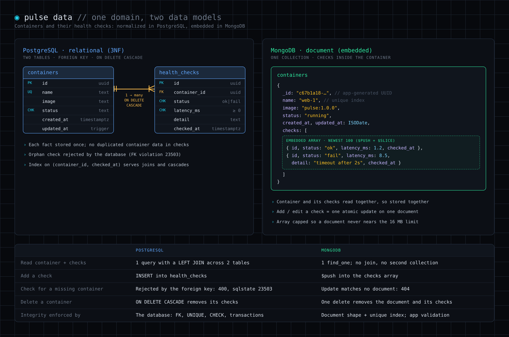
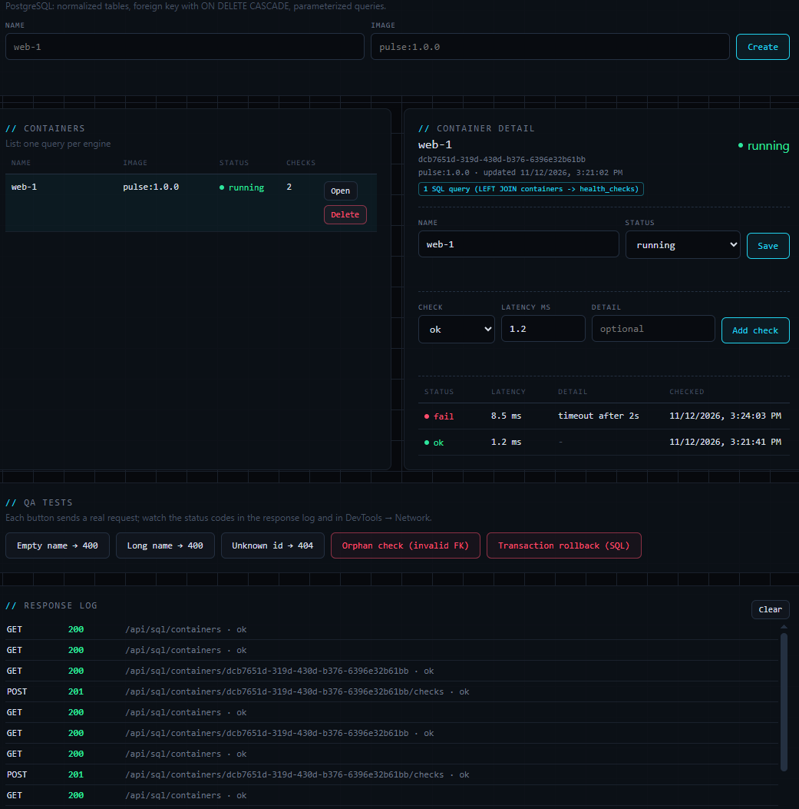
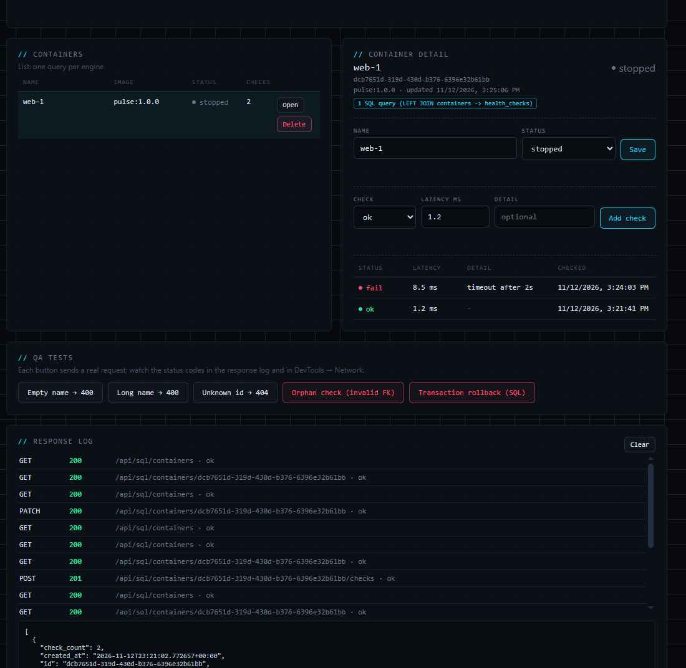
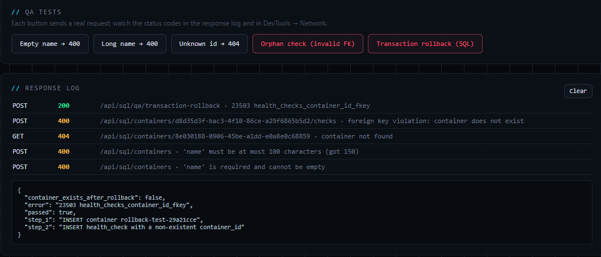
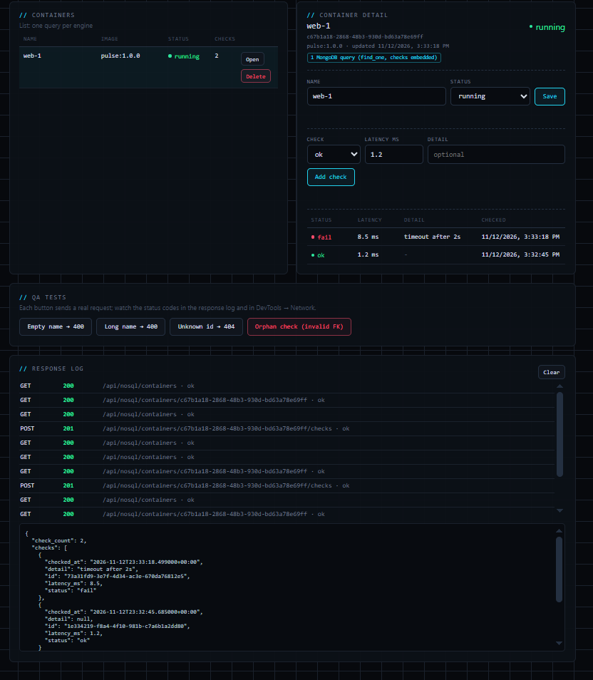
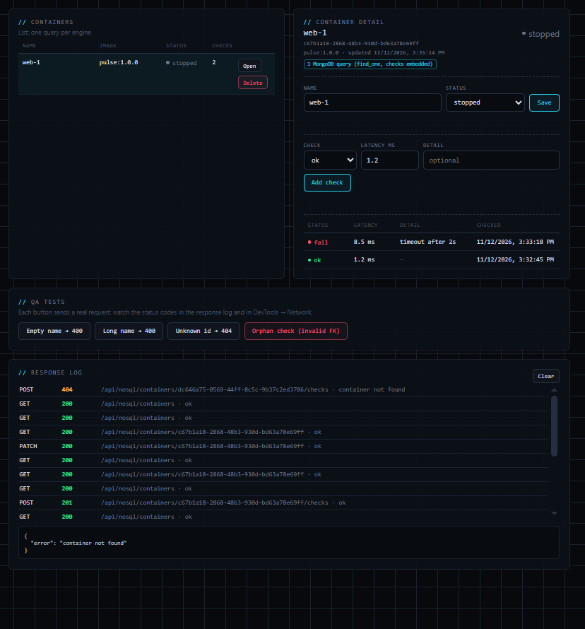
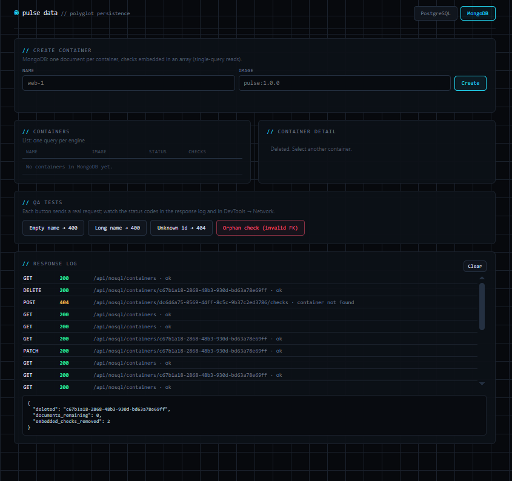

# Pulse Data: Polyglot Persistence

Pulse Data stores **containers** and their **health checks** in two databases at once, PostgreSQL and MongoDB, behind one API and one UI. The same feature is modeled the way each engine works best: normalized tables with enforced foreign keys in PostgreSQL, and one self-contained document per container in MongoDB.

It builds on [Pulse](../../WK6/pulse) (WK6), which monitored container health in memory; Pulse Data makes that data persistent.

**Reading order:** [Architecture](#architecture) → [Data models](#data-models) → [Walkthrough](#walkthrough) (screenshots, step by step) → [AI output audit](#ai-output-audit) → [When to choose SQL vs NoSQL](#when-to-choose-sql-vs-nosql-for-this-domain) → [Run guide](#run-guide) → [QA checklist](#qa-checklist).

## Architecture

```
                 Browser (single-page UI)  ·  curl  ·  QA test suite
                                   │
                                   ▼
                 ┌───────────────────────────────────┐
                 │  Flask API (gunicorn, 2 workers)  │   port 8000
                 │  /api/sql/...     /api/nosql/...  │
                 └──────────┬─────────────────┬──────┘
                            │                 │
            psycopg pool,   │                 │  pymongo client,
            parameterized   ▼                 ▼  single-document ops
                 ┌────────────────┐   ┌────────────────┐
                 │ PostgreSQL 16  │   │   MongoDB 7    │
                 │ containers     │   │ containers     │
                 │ health_checks  │   │ (checks        │
                 │ FK + CASCADE   │   │  embedded)     │
                 └────────────────┘   └────────────────┘
                   volume: pgdata       volume: mongodata
```

All three run in Docker Compose. Only the API publishes a port; the databases are reachable only on the internal Compose network.

**Why two engines?** They suit different access patterns:

| Workload | Best fit | Why |
|---|---|---|
| Integrity-critical relationships: every check must belong to a real container; deleting a container must clean up its history | PostgreSQL | Foreign keys, cascade rules, CHECK constraints and multi-statement transactions are enforced by the database itself |
| Fast "show this container with its recent checks" reads | MongoDB | The whole aggregate lives in one document, so a read is one `find_one` with no joins |

## Data models

The same domain, modeled two ways:



### Relational (PostgreSQL), third normal form

```
containers                              health_checks
──────────────────────────────          ──────────────────────────────────────
id          UUID  PK                ┌──<  id            UUID  PK
name        TEXT  UNIQUE NOT NULL   │    container_id  UUID  NOT NULL
image       TEXT  NOT NULL          │                  FK → containers.id ON DELETE CASCADE
status      TEXT  CHECK (running |  │    status        TEXT  CHECK (ok | fail)
                  stopped|unhealthy)│    latency_ms    NUMERIC(10,2) CHECK (>= 0)
created_at  TIMESTAMPTZ             │    detail        TEXT  (≤ 500 chars)
updated_at  TIMESTAMPTZ (trigger) ──┘    checked_at    TIMESTAMPTZ

INDEX idx_health_checks_container_checked ON health_checks (container_id, checked_at DESC)
```

- **3NF:** every non-key column depends only on its own table's key. Container facts are stored once, in `containers`; check facts are stored once, in `health_checks`. Nothing is duplicated.
- **Referential integrity:** `container_id` is a real `REFERENCES` constraint, so an orphan check is impossible. `ON DELETE CASCADE` removes a container's checks with it.
- **Foreign key index:** PostgreSQL does not index foreign key columns automatically. The composite index makes joins and cascade deletes use an index instead of a full table scan (verified with `EXPLAIN`).
- **Constraints in the database:** name length, allowed statuses and non-negative latency are `CHECK` constraints, so bad data is rejected even if a client bypasses the API.
- **`updated_at`** is maintained by a trigger, so it's correct no matter who writes the row.

Full DDL: [`db/schema.sql`](db/schema.sql).

### Document (MongoDB), query-driven and denormalized

One collection, `containers`. Each document embeds its checks:

```json
{
  "_id": "36799d3a-2b52-4781-a90d-2035157e7694",
  "name": "web-1",
  "image": "pulse:1.0.0",
  "status": "running",
  "created_at": "2026-11-12T20:44:27Z",
  "updated_at": "2026-11-12T20:45:02Z",
  "checks": [
    { "id": "ee348ced-…", "status": "ok",   "latency_ms": 1.3, "detail": null,              "checked_at": "…" },
    { "id": "a83e9d1a-…", "status": "fail", "latency_ms": 8.2, "detail": "timeout after 2s", "checked_at": "…" }
  ]
}
```

- **Embedded, not referenced:** checks are only ever read together with their container, so they live inside it. Reading a container with all its checks is **one query** (`find_one`), with no second collection and no application-side join.
- **Bounded array:** new checks are added with `$push` and `$slice: -100`, so a document keeps only the newest 100 checks and can never grow toward MongoDB's 16 MB document limit.
- **Atomic writes:** adding a check (`$push`) and editing one (`$set` with the positional `$` operator) each change a single document, which MongoDB applies atomically. No multi-document transaction is needed.
- **Unique index** on `name`, matching the SQL `UNIQUE` constraint.

### IDs

Both engines use **UUIDv4** keys generated by the application (`uuid.uuid4()`), with `gen_random_uuid()` as the PostgreSQL column default. UUIDs can be created by any process without asking a central sequence, so IDs never collide across workers or databases, and they don't reveal how many records exist the way auto-increment integers do. In MongoDB the UUID string is stored directly as `_id`.

## Walkthrough

This walkthrough follows one container, `web-1`, through its whole life in each database, using real results from this project running on Docker Desktop.

### 1. Start the stack

All three services start and pass their health checks. Only the API publishes a port; PostgreSQL (`5432`) and MongoDB (`27017`) stay internal.

```
$ docker compose ps
NAME                    IMAGE                  SERVICE    STATUS                    PORTS
pulse-data-app-1        pulse-data:1.0.0       app        Up 12 seconds (healthy)   0.0.0.0:8000->8000/tcp
pulse-data-mongo-1      mongo:7.0              mongo      Up 19 seconds (healthy)   27017/tcp
pulse-data-postgres-1   postgres:16.4-alpine   postgres   Up 19 seconds (healthy)   5432/tcp

$ curl -i http://localhost:8000/healthz
HTTP/1.1 200 OK
{"databases":{"nosql":"ok","sql":"ok"},"status":"ok"}
```

### 2. PostgreSQL: create and read with a join

On the **PostgreSQL** tab, `web-1` is created (`POST 201`) and given two health checks (`POST …/checks` → `201` each). Opening it loads the container **and** both checks with a single `LEFT JOIN`, as the badge shows. The newest check (`fail`) is listed first.



### 3. PostgreSQL: update

Changing the status to `stopped` (`PATCH 200`) shows immediately in both the detail panel and the list. The **updated** time moves from 3:21:02 to 3:25:06 PM without the app sending a timestamp: the `updated_at` trigger in the database sets it.



### 4. PostgreSQL: integrity and error handling

The QA buttons send bad requests on purpose. The first three are rejected by the API's validation; the last two are enforced by **PostgreSQL itself**:

- **Orphan check:** a check for a container that doesn't exist is rejected by the foreign key (`400`, `sqlstate 23503`, `health_checks_container_id_fkey`).
- **Transaction rollback:** a container and an orphan check are inserted in one transaction. The foreign key fails, the whole transaction rolls back, and the container does not exist afterwards (`passed: true`).



### 5. PostgreSQL: delete with cascade

Deleting `web-1` (`DELETE 200`) also removes its two checks through `ON DELETE CASCADE`. Querying the database directly confirms that no orphaned checks remain:

```
$ docker compose exec postgres psql -U pulse -d pulse -c "SELECT count(*) AS remaining_checks FROM health_checks WHERE container_id = 'dcb7651d-319d-430d-b376-6396e32b61bb';"
 remaining_checks
------------------
                0
(1 row)
```

### 6. MongoDB: one document, checks embedded

On the **MongoDB** tab, the same steps create `web-1` and push two checks into it (`$push`, `201` each). The detail loads with **one** `find_one`, and the response contains the `checks` array inside the container:



Looking at MongoDB directly shows the design: one document holds the container and its checks, with the app-generated UUID as `_id` and real BSON dates.

```
$ docker compose exec mongo mongosh -u pulse -p pulse_dev_password --quiet --eval "db.getSiblingDB('pulse').containers.findOne()"
{
  _id: 'c67b1a18-2868-48b3-930d-bd63a78e69ff',
  name: 'web-1',
  image: 'pulse:1.0.0',
  status: 'running',
  created_at: ISODate('2026-11-12T23:31:50.785Z'),
  updated_at: ISODate('2026-11-12T23:33:18.499Z'),
  checks: [
    { id: '1e334219-…', status: 'ok',   latency_ms: 1.2, detail: null,               checked_at: ISODate('2026-11-12T23:32:45.685Z') },
    { id: '73a31fd9-…', status: 'fail', latency_ms: 8.5, detail: 'timeout after 2s', checked_at: ISODate('2026-11-12T23:33:18.499Z') }
  ]
}
```

Compare this with PostgreSQL, where the same data lives in two tables linked by a foreign key.

### 7. MongoDB: update and a write to a missing document

The status update (`PATCH 200`) is a single atomic `$set` on the document. Then the **Orphan check** button tries to add a check to a container that doesn't exist. MongoDB has no foreign keys, so nothing errors in the database; the `$push` simply matches no document, and the API returns `404 container not found`.



### 8. MongoDB: delete and cleanup

Deleting the document (`DELETE 200`) removes the container and its embedded checks in one operation. Nothing is left behind and there are no child records to clean up:



### 9. Automated QA suite

The same checks, plus duplicate names, embedded-field updates and an SQL-injection string, run automatically against both live databases:

```
$ docker compose exec app sh -c "cd /srv && python -m unittest -v tests.test_qa"
test_both_databases_reachable ... ok
test_create_and_read_with_join ... ok
test_delete_cascades_to_checks ... ok
test_duplicate_name_conflict ... ok
test_orphan_check_rejected_by_foreign_key ... ok
test_transaction_rolls_back ... ok
test_update_reflects_immediately ... ok
test_atomic_update_of_embedded_field ... ok
test_check_on_missing_document_404 ... ok
test_create_and_read_single_query ... ok
test_delete_cleans_up ... ok
test_push_into_embedded_array ... ok
test_injection_string_is_stored_as_data ... ok
test_status_codes ... ok
----------------------------------------------------------------------
Ran 14 tests in 0.691s

OK
```

## AI output audit

The AI's draft was checked against the assignment's Data Architecture Audit Checklist before running it.

| Checklist question | Result | Evidence |
|---|---|---|
| **SQL referential integrity:** real foreign keys, FK indexes and cascade rules? | ✅ Pass | `container_id UUID NOT NULL REFERENCES containers(id) ON DELETE CASCADE`; explicit composite index on `(container_id, checked_at)`, confirmed with `EXPLAIN` (index scan, no sequential scan) |
| **NoSQL anti-patterns:** separate collections joined by ObjectId, or embedding that matches the read pattern? | ✅ Pass | One `containers` collection with embedded `checks`; detail read is a single `find_one`. Array bounded with `$slice` |
| **SQL injection & parameterization:** raw string concatenation, or bound parameters? | ✅ Pass | Every value is a `%s` placeholder bound by psycopg. UPDATE column names come from a fixed allow-list, quoted with `psycopg.sql.Identifier`. The only f-string in SQL inserts a constant column list, never user input. A QA test stores `x'); DROP TABLE containers; --` as a plain name |
| **ID & primary key generation:** safe across distributed boundaries? | ✅ Pass | UUIDv4 generated in the app for both engines; no shared counters |

**Issues found in review and testing**

| Finding | Type | How this project handles it |
|---|---|---|
| A non-object `initial_check` value (for example a string) reached code that expected a dictionary, producing a 500 instead of a 400 | Error handling | Input is type-checked first; the API returns `400 a check must be a JSON object` |
| Browser requested `/favicon.ico`, adding a 404 to the console during QA | Console health | The page declares an empty inline icon |
| Opening database clients at import time would be shared across gunicorn's forked workers (pymongo warns about this) | Driver warnings / connection safety | Clients are created lazily inside each worker on first use, and pools are closed on exit |
| An embedded array that grows forever is a known MongoDB anti-pattern | NoSQL design | `$push` with `$slice: -100` caps the array |
| After a delete, the automatic list refresh replaced the delete response in the UI, hiding `cascaded_checks` / `remaining_checks` | UI / QA visibility | Background list reloads are logged but no longer overwrite the response panel |

## When to choose SQL vs NoSQL (for this domain)

**Heuristic:** choose by *how the data is read* and *what bad data would cost*.

| Choose | When | In Pulse Data |
|---|---|---|
| **PostgreSQL (SQL)** | The relationship itself must be guaranteed; child records are queried on their own or across parents; you need reporting and multi-row transactions | Health-check **history**: "every check belongs to a real container", "all failed checks across the fleet in the last hour", audits. A foreign key and a JOIN make these safe and simple |
| **MongoDB (NoSQL)** | Data is read and written as one unit; children have no life outside the parent; the child list is bounded | The **dashboard view**: "show this container with its latest checks" is one `find_one`, and adding a check is one atomic `$push` |

**Rule of thumb:** if children are always accessed through their parent and stay bounded, **embed** them (document). If they're queried independently, shared, or grow without limit, give them their **own table with a foreign key** (relational).

For this domain, PostgreSQL is the better system of record, because health history needs guaranteed integrity and cross-container queries. MongoDB fits the per-container dashboard read model.

## Prerequisites

- Docker Desktop with Docker Compose v2 (`docker compose version`)
- Port 8000 free

## Run guide

All commands are run from this folder (`WK7/pulse-data`).

**Build and start the stack**

```bash
docker compose up -d --build
docker compose ps
```

Wait until all three services show `(healthy)`. On the very first start, PostgreSQL runs `db/schema.sql` automatically.

**Open the app**

- UI: http://localhost:8000. Switch between **PostgreSQL** and **MongoDB** with the tabs at the top.
- Health of both databases: `curl -i http://localhost:8000/healthz`

**Run the QA test suite** (14 automated tests covering the checklist below)

```bash
docker compose exec app sh -c "cd /srv && python -m unittest -v tests.test_qa"
```

**Watch parameterized queries in the logs**

```bash
docker compose logs -f app
```

Every SQL statement is logged with its `%s` placeholders and the separately bound parameter list.

**Inspect the databases directly (CLI)**

PostgreSQL: table structure, the rows in both tables, and the joined view the API returns:

```bash
docker compose exec postgres psql -U pulse -d pulse -c "\d health_checks"
docker compose exec postgres psql -U pulse -d pulse -c "SELECT id, name, image, status, updated_at FROM containers;"
docker compose exec postgres psql -U pulse -d pulse -c "SELECT container_id, status, latency_ms, detail, checked_at FROM health_checks ORDER BY checked_at;"
docker compose exec postgres psql -U pulse -d pulse -c "SELECT c.name, h.status, h.latency_ms, h.detail FROM containers c JOIN health_checks h ON h.container_id = c.id ORDER BY h.checked_at;"
```

PostgreSQL itself blocking an orphan row, with no API involved:

```bash
docker compose exec postgres psql -U pulse -d pulse -c "INSERT INTO health_checks (container_id, status, latency_ms) VALUES (gen_random_uuid(), 'ok', 1);"
# ERROR:  insert or update on table "health_checks" violates foreign key constraint "health_checks_container_id_fkey"
```

MongoDB: the whole document, and how many there are:

```bash
docker compose exec mongo mongosh -u pulse -p pulse_dev_password --quiet --eval "db.getSiblingDB('pulse').containers.find().toArray()"
docker compose exec mongo mongosh -u pulse -p pulse_dev_password --quiet --eval "db.getSiblingDB('pulse').containers.countDocuments()"
```

**See the round trips per read**

Open one container in the UI, then look at what each engine ran to load it:

```bash
docker compose logs app | grep -E "SQL SELECT c.id|MONGO containers.find_one" | tail -4
```

PostgreSQL loads the container and its checks with one `LEFT JOIN`; MongoDB with one `find_one`. If MongoDB stored checks in a separate collection (the "SQL-shaped NoSQL" anti-pattern), the same screen would need two round trips, `find_one` on `containers` and then `find` on `checks`, joined in the application.

**Tear down**

```bash
docker compose down        # stop; data is kept in volumes
docker compose down -v     # stop and delete all data
```

The schema file only runs when the PostgreSQL volume is empty. After changing `db/schema.sql`, run `docker compose down -v` first.

## API

Replace `{engine}` with `sql` (PostgreSQL) or `nosql` (MongoDB). Both engines accept the same requests and return the same JSON shape.

| Method & path | Purpose | Success | Errors |
|---|---|---|---|
| `GET /api/{engine}/containers` | List containers with check counts | 200 | |
| `POST /api/{engine}/containers` | Create. Body: `{"name", "image", "initial_check"?}` | 201 | 400 invalid input, 409 duplicate name |
| `GET /api/{engine}/containers/{id}` | Read one container **with all its checks** | 200 | 400 bad id, 404 |
| `PATCH /api/{engine}/containers/{id}` | Update `name`, `image` and/or `status` | 200 | 400, 404, 409 |
| `DELETE /api/{engine}/containers/{id}` | Delete; reports cascaded or embedded checks removed | 200 | 400, 404 |
| `POST /api/{engine}/containers/{id}/checks` | Add a check. Body: `{"status", "latency_ms", "detail"?}` | 201 | 400 (SQL: foreign key violation), 404 (Mongo: no document) |
| `PATCH /api/{engine}/containers/{id}/checks/{checkId}` | Update a check's `status` or `detail` | 200 | 400, 404 |
| `POST /api/sql/qa/transaction-rollback` | Inserts a container and an orphan check in one transaction; proves the rollback | 200 | |
| `GET /healthz` | Ping both databases | 200 | 503 |

In SQL, creating a container with `initial_check` writes both rows in **one transaction**.

## QA checklist

Automated coverage: `tests/test_qa.py`. Tick each row after running it yourself.

**1. Relational (SQL) CRUD & integrity**

| Test | How | Expected | Result |
|---|---|---|---|
| Create & read with join | Create a container, add a check, open it | Detail shows the check; badge reads "1 SQL query (LEFT JOIN …)" | ✅ `web-1` with 2 checks (ok, fail) returned by one LEFT JOIN |
| Update | Change status to `stopped`, reopen | New value shows immediately | ✅ `PATCH 200`; shows `stopped` at once; `updated_at` moved from 3:21:02 to 3:25:06 PM via the trigger |
| Delete & cascade | Delete a container that has checks | Response shows `cascaded_checks: N`, `remaining_checks: 0` | ✅ `DELETE 200`; `psql` confirms `remaining_checks = 0` |
| Negative constraint (orphan) | **Orphan check (invalid FK)** button | `400`, `sqlstate 23503`, `health_checks_container_id_fkey` | ✅ `400`, `sqlstate 23503`, `health_checks_container_id_fkey` |
| Transaction integrity | **Transaction rollback (SQL)** button | `passed: true`, `container_exists_after_rollback: false` | ✅ `200`, `passed: true`, `container_exists_after_rollback: false` |

**2. NoSQL CRUD & documents**

| Test | How | Expected | Result |
|---|---|---|---|
| Create & read in one query | MongoDB tab: create, open | Badge reads "1 MongoDB query (find_one, checks embedded)" | ✅ `201`; one `find_one` returns the container with its `checks` array; `mongosh findOne()` shows one document |
| Atomic push into embedded array | Add a check | `201`; check appears inside the same document | ✅ Two `$push` writes (`201` each); both checks inside the same document |
| Atomic embedded update | `PATCH …/checks/{checkId}` with `{"detail": "…"}` | `200`; detail changes in place | ✅ `test_atomic_update_of_embedded_field` passed against live MongoDB |
| Delete & cleanup | Delete a container | `documents_remaining: 0`; reopening returns `404` | ✅ `DELETE 200`; `embedded_checks_removed: 2`, `documents_remaining: 0` |
| Child write on a missing document | **Orphan check** button on the MongoDB tab | `404` (no foreign keys in MongoDB; the update matches no document) | ✅ `404 container not found` |

**3. UI & responsive design**

| Test | Expected | Result |
|---|---|---|
| Desktop and mobile (DevTools device toolbar, e.g. iPhone 12) | Tables render on desktop; stacked cards on mobile, no horizontal scrolling | ⬜ |
| Empty inputs | Inline "Name and image are required."; no request sent | ⬜ |
| Long text | A very long name wraps without clipping; API rejects names over 100 characters with `400` | ⬜ |

**4. Browser console & terminal health**

| Test | Expected | Result |
|---|---|---|
| DevTools → Network | `200` reads, `201` creates, `400` bad input/FK, `404` unknown id, `409` duplicate | ⬜ |
| `docker compose logs app` | `SQL … %s … \| params=[…]` lines; no driver warnings, no connection errors | ✅ SQL logged with placeholders and a separate params list; no warnings or connection errors |
| QA suite | `Ran 14 tests … OK` | ✅ `Ran 14 tests in 0.691s OK` against live PostgreSQL 16 and MongoDB 7 |

## Project files

```
pulse-data/
├── app/
│   ├── app.py           # Flask routes, validation, error → status code mapping
│   ├── sql_repo.py      # PostgreSQL: pooled connections, parameterized SQL, transactions
│   ├── mongo_repo.py    # MongoDB: embedded documents, atomic $push / $set
│   ├── errors.py        # shared errors (NotFound, Conflict, ConstraintError)
│   └── static/index.html  # single-page UI
├── db/schema.sql        # DDL: tables, FK, CASCADE, CHECKs, index, trigger
├── tests/test_qa.py     # automated QA suite (standard library only)
├── Dockerfile           # Python 3.12 slim, non-root user, health check
├── compose.yaml         # postgres + mongo + app, volumes, health checks, hardening
├── requirements.txt     # pinned dependencies
└── screenshots/       # images for this README, including data-models.png
```

## AI disclosure & prompt log

**AI tool used:** Claude (Anthropic), Claude Opus 5.5 in the Claude app. It generated the schemas, API, UI, test suite and Docker files. I chose the domain and the scope, ran the build and the tests on my machine, and reviewed the output against the audit checklist above.

### Prompts (spelling and grammar corrected)

1. Provided this assignment ("Polyglot Persistence: Schema Modeling & CRUD in SQL and NoSQL") and asked: "Now I need to do this."
2. "Let's talk about systems: what I already have, and am I able to use these?"
3. "Use Pulse." (Chose the Pulse domain: containers and health checks, built with Python and Flask, PostgreSQL and MongoDB in Docker Compose.)
4. "Do I do this first?" (resetting both databases before testing), and shared screenshots and terminal output from each test run (SQL and MongoDB CRUD, QA buttons, `psql` and `mongosh` checks) for review.
5. "Add the screenshots I gave you into the screenshots folder."
6. "Make sure the README connects to each screenshot with a storyline from start to finish so readers can follow easily."
7. "Do the images depict the walkthrough statements? Are we using the correct images from start to finish?"
8. "Do I have this?" (side-by-side data models and a flaw caught in the AI draft) and "Do that and check these as well." (the remaining video requirements: SQL and NoSQL CLI walkthroughs, round trips, QA checklist and an SQL vs NoSQL heuristic)
