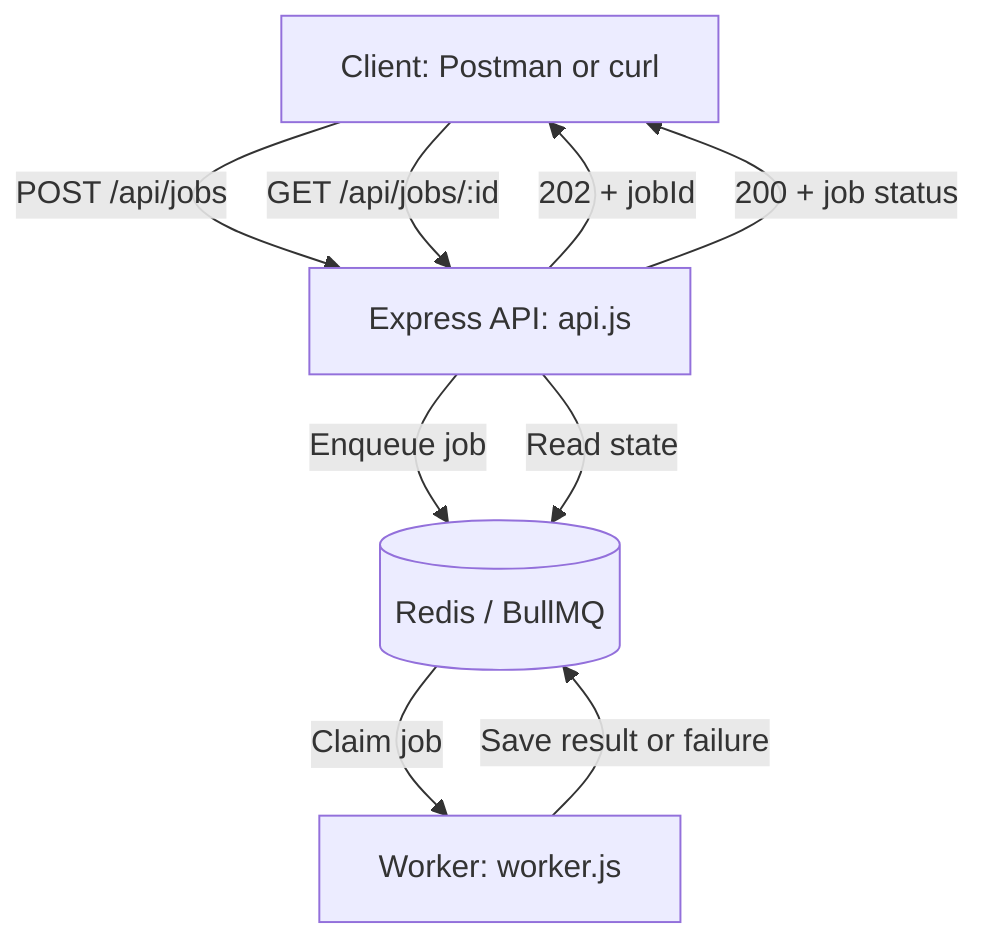
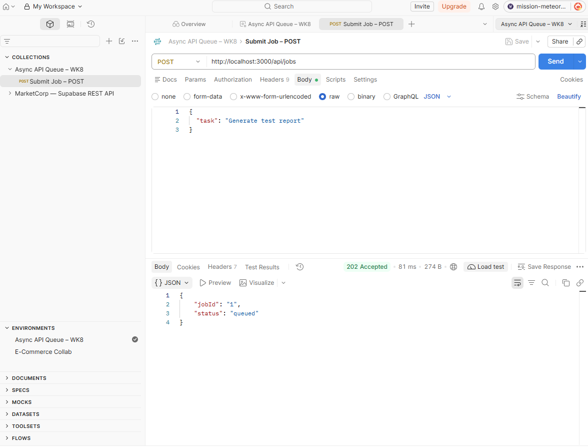
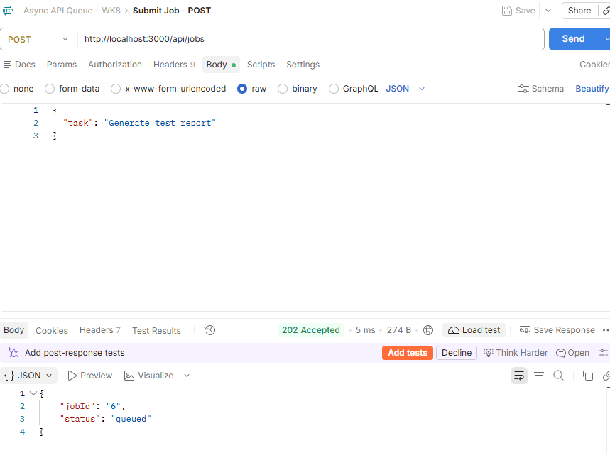
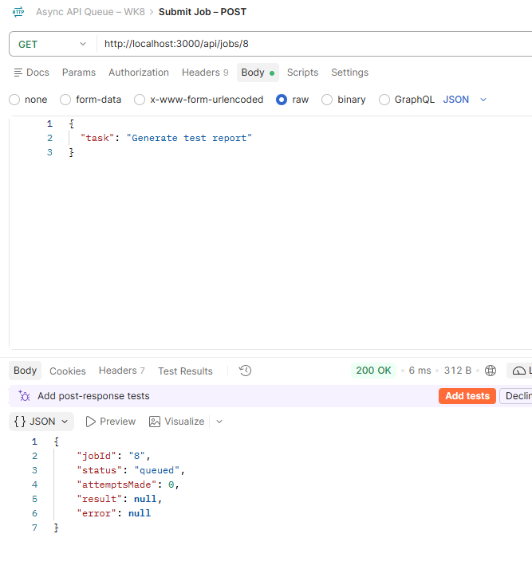
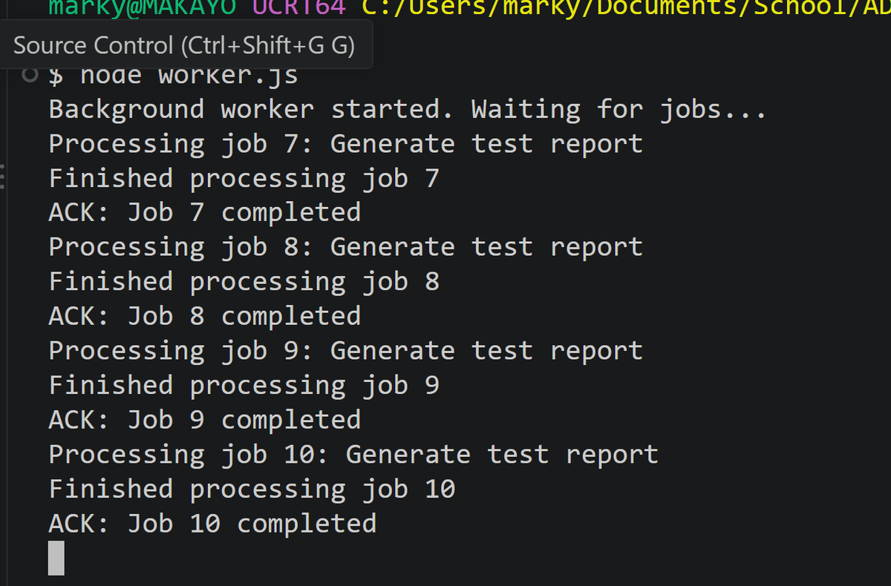
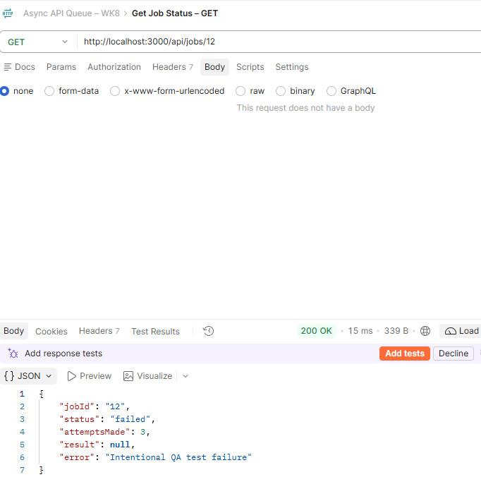
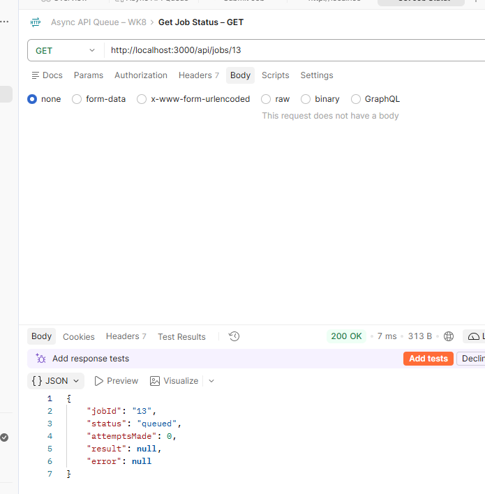
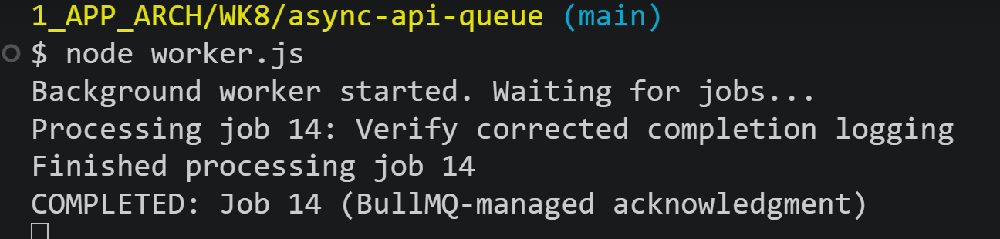

# Asynchronous REST API & Redis Message Queue — Week 8

**AD371 Application Architecture | Node.js · Express · Redis · BullMQ**

This project demonstrates **temporal decoupling**: an Express API accepts a job and returns HTTP `202 Accepted` after Redis confirms it was queued. A separate BullMQ worker processes the job asynchronously and stores its result in Redis. The project runs locally with Docker and Postman or `curl`.

## 1. Setup and Run

**Requirements:** Node.js, npm, Docker, and Postman (or `curl`). Tested with Node.js 22.22.2, BullMQ 6.7.7, Express 5.3.0, and Redis `7-alpine`. PostgreSQL and Docker Compose are not needed.

From `AD371_APP_ARCH/WK8/async-api-queue/`, install dependencies:

```bash
npm install
```

Create Redis **once**, with a persistent volume and append-only persistence:

```bash
docker pull redis:7-alpine
docker run -d \
  --name async-api-redis \
  -p 127.0.0.1:6379:6379 \
  -v async-api-redis-data:/data \
  redis:7-alpine redis-server --appendonly yes
```

On later runs, use `docker start async-api-redis`. Check connectivity with `docker exec async-api-redis redis-cli ping` (expected: `PONG`). Start the API and worker in **separate terminals**:

```bash
# Terminal 1
node api.js

# Terminal 2
node worker.js
```

Submit a job and poll its status (replace `1` with the returned `jobId`):

```bash
curl -i -X POST http://localhost:3000/api/jobs \
  -H "Content-Type: application/json" \
  -d '{"task":"Generate test report"}'

curl -i http://localhost:3000/api/jobs/1
```

The POST returns `202` and a `jobId`; GET reports `queued`, `processing`, `completed`, or `failed`. To shut down, press **Ctrl+C** in both Node.js terminals, then run `docker stop async-api-redis`. Keep the Docker volume for persistence tests.

## 2. Architecture



The API waits for **enqueue confirmation, not job completion**. The independent worker processes one job at a time (`concurrency: 1`) with a simulated five-second delay. Redis acts as both the message broker and job-status store. The trade-off is faster API responses and buffering during worker downtime in exchange for polling, broker operations, and possible duplicate execution when recovering failed work.

## 3. Implementation

- **Producer (`api.js`):** Validates a nonempty JSON `task`, calls `jobQueue.add()`, and returns `202` with the job ID. `GET /api/jobs/:id` reads BullMQ state, attempts, and result/error; unknown jobs return `404`. Submission errors return `503`.
- **Queue policy:** Three total attempts, fixed 1,000 ms backoff, and `removeOnComplete: false` / `removeOnFail: false` to retain test records.
- **Consumer (`worker.js`):** Processes queued jobs separately. The exact task `TEST_RETRY_FAILURE` deliberately throws an error for retry QA; other tasks complete after five seconds.
- **Completion handling:** BullMQ manages locks, state transitions, retries, and stalled-job recovery. The `completed` event listener records a log; it does **not** manually ACK the job.

See `api.js` and `worker.js` for the complete source rather than duplicating it here.

## 4. QA Results

All seven documented scenarios passed in the local test session. Response timings are observations, not performance guarantees.

| Test                                | Observed result                                                                                                                                     |
| ----------------------------------- | --------------------------------------------------------------------------------------------------------------------------------------------------- |
| **Job 1 — Async submission**        | `202` in **81 ms**; later `completed` after worker processing.                                                                                      |
| **Jobs 2–6 — Burst**                | Five additional jobs accepted and processed sequentially; Job 6 POST took **5 ms**. Direct queue-depth snapshot was not captured.                   |
| **Jobs 7–10 — Worker offline**      | Worker stopped with Ctrl+C; Job 8 returned `202` in **6 ms**, remained `queued` with zero attempts; all pending jobs completed after restart.       |
| **Job 11 — Interrupted processing** | Stopped worker mid-task; job initially still reported `processing`, then recovered and completed after restart.                                     |
| **Job 12 — Retry**                  | `TEST_RETRY_FAILURE` failed three times; final status `failed`, `attemptsMade: 3`; worker remained available.                                       |
| **Job 13 — Redis restart**          | Job submitted in **59 ms** while worker was offline; remained `queued` after `docker restart async-api-redis`, then completed after worker restart. |
| **Job 14 — Audit fix**              | `202` in **33 ms**; worker completed and emitted corrected BullMQ completion logging.                                                               |

### Selected screenshots

The full QA screenshot set is retained in [`images/`](images/). The following examples highlight the required asynchronous flow, recovery, and AI audit fix.

<p align="center"></p>
<p align="center"><em>Job 1: the API accepted work without waiting for processing.</em></p>

<p align="center"></p>
<p align="center"><em>Burst test: Job 6 returned HTTP 202 in 5 ms.</em></p>

<p align="center"></p>
<p align="center"><em>Worker-offline test: Job 8 remained queued.</em></p>

<p align="center"></p>
<p align="center"><em>Restarted worker processed Jobs 7–10.</em></p>

<p align="center"></p>
<p align="center"><em>Retry test: Job 12 reached a retained failed state after three attempts.</em></p>

<p align="center"></p>
<p align="center"><em>Durability test: Job 13 remained queued after controlled Redis restart.</em></p>

<p align="center"></p>
<p align="center"><em>AI audit: Job 14 emitted the corrected completion message.</em></p>

**Test boundaries:** The worker interruptions used Ctrl+C, not forced OS termination. Redis durability was verified for a **controlled restart with AOF enabled**, not sudden power loss. The tests do not prove exactly-once execution.

## 5. AI Code Audit

**Tool:** OpenAI ChatGPT assisted with the API, queue, worker, and QA procedures. Generated code was reviewed against observed tests.

**Issue found and corrected:** The original worker logged a `completed` event as `ACK: Job ... completed`, misleadingly suggesting the event handler itself acknowledged the job. BullMQ manages job completion internally. The worker now logs:

```javascript
worker.on("completed", (job) => {
  console.log(`COMPLETED: Job ${job.id} (BullMQ-managed acknowledgment)`);
});
```

`node --check worker.js` passed; Job 14 returned `202` in **33 ms** and produced the corrected log (Section 4). This was an **observability wording fix**, not new application-level ACK/NACK logic. The `TEST_RETRY_FAILURE` branch was also added so the configured three-attempt retry policy could be tested with Job 12.

**Known limitations:** Failed jobs are retained (`removeOnFail: false`) but there is **no dedicated DLQ**. The worker simulates processing without external writes; real side effects would require application-level **idempotency** to prevent duplicates on retry or recovery.

## 6. AI Prompt Record

The development used the instructor's assignment specification and iterative ChatGPT instructions. Verified verbatim user excerpts include:

> "not too complicated"
>
> "i have postman, redis, node, python, express, docker, and postgresql already"

These are **selected excerpts**, not the complete coding-prompt history.

## 7. Broker Inspection for Video

```bash
docker ps --filter name=async-api-redis
docker exec async-api-redis redis-cli ping
docker exec async-api-redis redis-cli LLEN bull:jobs:wait
docker logs --tail 30 async-api-redis
```

`LLEN` measures only the BullMQ **waiting list**, not active, delayed, completed, or failed jobs. In the required 5–7-minute screen-and-webcam walkthrough, demonstrate HTTP `202`, burst buffering with live queue inspection, worker stop/restart, and relevant DevTools requests. Postman's Desktop Agent may issue localhost requests that do not appear as normal browser Network entries; report only visible activity.

**Live demo URL:** N/A — local Docker architecture.
